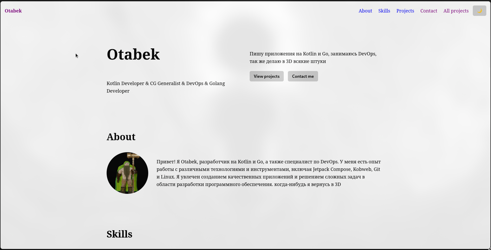
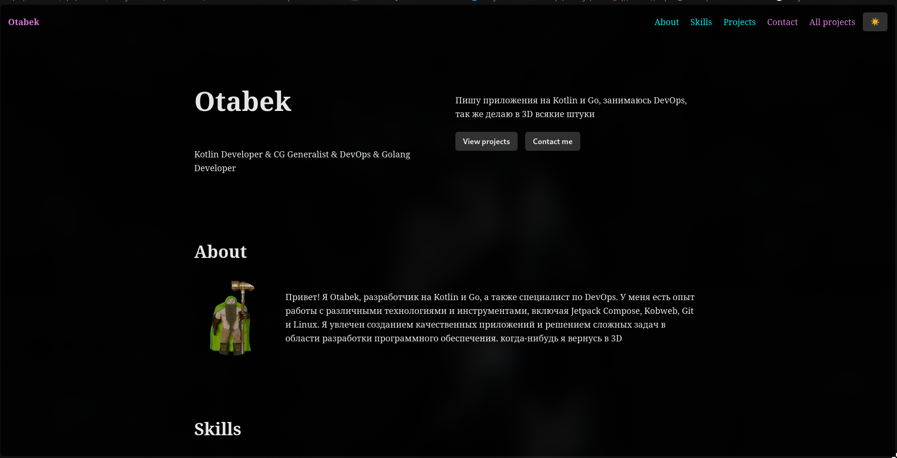

# Kobweb Portfolio

Personal portfolio of Otabek - Kotlin, Flutter and Go developer, DevOps and CG generalist.
Built with [Kobweb](https://kobweb.varabyte.com/) (Kotlin + Compose HTML), exported as a static site and deployed to GitHub Pages.

**Live:** https://otabek228101.github.io/Kobweb-Portfolio/

| Light mode | Dark mode |
|---|---|
|  |  |

Responsive screenshots: [360 px](docs/screenshots/mobile-360.png) · [768 px](docs/screenshots/tablet-768.png) · [1280 px](docs/screenshots/desktop-1280.png)

## Run locally

Requirements: JDK 17+, Git, [Kobweb CLI](https://kobweb.varabyte.com/docs/getting-started/getting-kobweb) 0.9.23.

```bash
git clone https://github.com/Otabek228101/Kobweb-Portfolio.git
cd Kobweb-Portfolio/site

# Development server with live reload
kobweb run
# open http://localhost:8081/Kobweb-Portfolio/  (port is set in site/.kobweb/conf.yaml)
# press Q to stop
```

## Export and preview the production build

```bash
cd site
kobweb stop                              # the dev server must not be running
kobweb export --layout static            # output: site/.kobweb/site
kobweb run --env prod --layout static    # serve the export like a static host
```

The first export downloads a headless browser, so it needs internet access and takes a few minutes.

## Project structure

```
site/src/jsMain/kotlin/com/otabek/portfolio/
├── AppEntry.kt              @App entry, @InitSilk color mode setup
├── SiteStyles.kt            global typography per breakpoint, SplitStyle
├── pages/                   route-backed @Page composables only
│   ├── Index.kt             "/"         - assembles the landing sections
│   └── Projects.kt          "/projects" - all projects
├── components/
│   ├── layouts/PageLayout.kt   @Layout: header + main + footer
│   ├── sections/               one composable per landing section, NavHeader, SiteFooter
│   └── widgets/                ProjectCard, Tag, SectionContainer, ColorModeToggle, PageMeta
└── data/
    ├── Portfolio.kt         typed content: projects, skills, links, bio
    └── Pages.kt             per-page title and meta description
```

## Architecture decisions

| Decision | Reason |
|---|---|
| **Static layout, not full-stack** | A portfolio has no dynamic data, so every page can be pre-rendered once and served by any static host for free. |
| **No `@Api` routes, no server module** | Nothing needs a backend: contact is a `mailto:` link and the resume is a static PDF. A server would only add hosting cost and attack surface. |
| **Silk for UI** | Gives `CssStyle` with variants, breakpoints, light/dark palettes and base-path-aware `Link`/`Image` out of the box. |
| **Content in `data/`** | All texts, projects, skills and links are typed Kotlin data. Sections are pure functions of that data, so the UI can be redesigned without touching content. |
| **One shared `@Layout`** | `PageLayout` renders header, `<main>` and footer for every page; navigation items are defined once in `NavHeader`. |
| **Reusable styling with `CssStyle`** | `ProjectCardStyle` (base + hover) with a `featured` variant, and `TagStyle`; changing the style in one place changes every card. |
| **Responsive design** | Silk breakpoints: burger menu below `md`, project grid 1 / 2 / 3 columns, hero stacks vertically on small screens, font sizes step up per breakpoint. |
| **Light and dark mode** | Initial mode is set in `@InitSilk` in `AppEntry.kt`: saved choice from localStorage, otherwise the OS preference. Every hard-coded color has a light and a dark value. |
| **Base path** | `site.basePath: "Kobweb-Portfolio"` in `conf.yaml`, because the site is served from `/<repo>/`. Silk widgets add it automatically; the raw `<a>` for the resume uses `BasePath.prependTo`. |
| **Deployment** | GitHub Actions (`.github/workflows/deploy.yml`): on push to `main` it runs `kobweb export --notty --layout static` and publishes `site/.kobweb/site` with `actions/deploy-pages`. |

## Assets

| Asset | Path | Element | Base path |
|---|---|---|---|
| Profile photo | `/images/profile.webp` | Silk `Image` | automatic |
| Project previews | `/images/ak-47.webp`, `/images/saiga-12.webp` | Silk `Image` | automatic |
| Resume | `/resume.pdf` | raw `A` with `download` | manual, `BasePath.prependTo` |
| Favicon | `/favicon.ico` | `<link rel="icon">` generated by Kobweb | automatic |
| Open Graph image | `/images/og.png` | `<meta property="og:image">` | absolute URL in `build.gradle.kts` |
| JS bundle | `/portfolio.js` | `<script>` generated by Kobweb | automatic |

Images are converted to WebP (≈15-20 KB each instead of ≈1 MB PNG).

## SEO note

`kobweb export` opens every page in a headless browser and saves the fully rendered HTML, so the exported `index.html` already contains my name, headings, title and meta description. A purely client-rendered page would ship an empty root `<div>` that crawlers and link previews could not read.

## When would this project need more than a static site?

If the portfolio needed data that changes per request or must stay private - a working contact form that stores messages, an admin panel to edit projects, or authentication - it would need Kobweb's server side with `@Api` routes. If it became a large content site with many authors, a headless CMS or a static generator built for content would be easier to maintain. For an app-like experience shared with Android and iOS, Compose Multiplatform for Web would let the same UI code run on every platform.